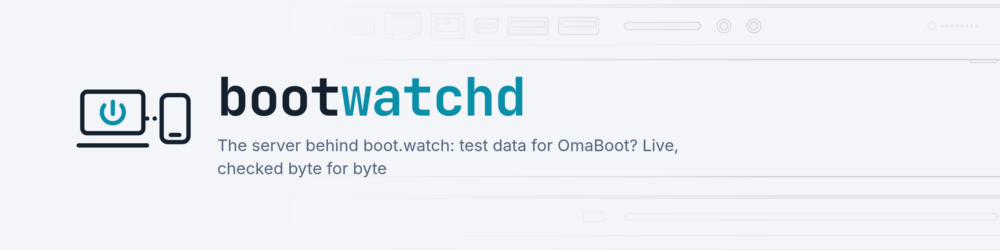

<p align="center">
  <picture>
    <source media="(prefers-color-scheme: dark)" srcset=".github/assets/header-dark.png">
    
  </picture>
</p>

<p align="center">
  <a href="https://github.com/omaboot/bootwatchd/tags"></a>
</p>

# bootwatchd

boot.watch's server. OmaBoot? Live's Wi-Fi and Ethernet checks move their test data through it
and check every byte, both ways, so a sign-in page, a proxy's error page or a broken adapter
can't pass for data. Later it also carries the phone relay.

It keeps no request log and no addresses on disk. Limits are kept in memory per address and
forgotten after an hour; the counters are totals only. On disk there's only today's byte count
(`$STATE_DIRECTORY/day`, saved every 10 s and at shutdown), so a restart doesn't reset the daily
cap.

## Protocol (v1)

Small and public: anyone can run their own server, and a client in any language can use it.

| Request | Answer | Limits |
|---|---|---|
| `GET /v1/echo?n=<32 hex>` | The nonce, as `text/plain`, exactly as sent (lowercase hex). | 600 a minute per address |
| `GET /v1/stream?seed=<32 hex>&n=<bytes>` | The first `n` bytes of the seed's stream, `application/octet-stream`, with `Content-Length`. | `1 ≤ n ≤ 1048576`; 64 MiB an hour per address |
| `POST /v1/sink?seed=<32 hex>` + body | `{"n": <bytes read>, "match": <leading bytes equal to the seed's stream>}` | `Content-Length` required, ≤ 262144; 16 MiB an hour per address |
| `GET /v1/health` | The counters as JSON (totals since start; bytes today, and `day_bytes_since`, when that count started: midnight UTC, or the server's first start that day) and the server's `version`, for monitoring. | |

Every answer carries `Cache-Control: no-store, no-transform`. Stream and sink bytes count
against a global 4 GiB a day (UTC) as well. Over a limit the answer is `429` with `Retry-After`.
Behind Cloudflare (`-cloudflare`) the address is `CF-Connecting-IP`; an IPv6 address counts by
its /64. Malformed requests get `400`, `405`, `411` or `413` with a one-line reason.

### The stream

AES-128 in CTR mode, the seed as the key, a zero initial counter block (the whole 16 bytes count
up as one big-endian number), over zero plaintext: the keystream itself. Standard everywhere:

```
head -c 32 /dev/zero | openssl enc -aes-128-ctr -K <seed> -iv 00000000000000000000000000000000
```

Test vectors (first 32 bytes):

| Seed | Stream |
|---|---|
| `00000000000000000000000000000000` | `66e94bd4ef8a2c3b884cfa59ca342b2e58e2fccefa7e3061367f1d57a4e7455a` |
| `000102030405060708090a0b0c0d0e0f` | `c6a13b37878f5b826f4f8162a1c8d8797346139595c0b41e497bbde365f42d0a` |

A seed means nothing outside its request: the client picks a fresh random one each time.

### How OmaBoot? Live uses it

Over one connection bound to the adapter under test (`SO_BINDTODEVICE`), 15 s at most:

1. For an HTTPS server, an echo over plain HTTP first. A captive portal can't show its page
   inside verified TLS, only over plain HTTP: a redirect elsewhere, `511`, or another page means
   the network wants a sign-in page. A redirect to the same host's HTTPS address is only HTTPS
   enforcement and is ignored.
2. Six echoes over the server's own scheme; the last five give the round trip. A certificate
   for another name or from an unknown authority means someone else answered (a sign-in page or
   a proxy); one outside its dates means the client's clock is off.
3. Stream parts of 64 KB and 256 KB, every byte compared.
4. 64 KB to the sink; the answer must say all of it matched.
5. A 1 MB stream part cut at 2 s, only to measure speed.

The adapter's byte counters must have grown by at least what moved. Data verified both ways
passes. A failure counts against the adapter only when the server was there to answer.

## Running

```
make build                      # dist/bootwatchd, static
./dist/bootwatchd -listen :8470 # development: plain HTTP
```

| Flag | |
|---|---|
| `-listen ADDR` | Where to listen (default `:8470`). |
| `-cert FILE`, `-key FILE` | Serve TLS itself (a self-hosted server without a proxy in front). Without them, plain HTTP. |
| `-cloudflare` | Take the client's address from `CF-Connecting-IP`. Only where nothing but Cloudflare can reach it (a tunnel, or a firewall admitting Cloudflare alone). |

## Deploying

`deploy/root/` holds the system files; the unit (`bootwatchd.service`: `DynamicUser`, no
capabilities, read-only system) listens on `:8470` in plain HTTP.

- **Development (a LAN host):** copy `dist/bootwatchd`, `deploy/install.sh` and `deploy/root/`
  to one directory on the host, then `sudo ./install.sh`. Open the port to the LAN only (e.g.
  `sudo ufw allow from <lan>/<prefix> to any port 8470 proto tcp`; every subnet a test Mac may
  join, Wi-Fi included). Dev images point at it with `watch=http://<host>:8470` in
  `target.conf`.
- **Production (boot.watch):** a DigitalOcean droplet behind a Cloudflare Tunnel. No inbound
  HTTP at all: cloudflared dials out, the droplet's firewall admits SSH only, and bootwatchd
  listens on `127.0.0.1:8470` with `-cloudflare`
  (`bootwatchd.service.d/production.conf`).
  1. `deploy/provision.sh` creates the droplet (`s-1vcpu-512mb-10gb`, Debian 13, tag
     `bootwatch`; its name, region and project from `deploy/local.env`) and its firewall
     (`bootwatch-ssh`),
     builds bootwatchd and runs `deploy/setup.sh` on it: cloudflared from Cloudflare's apt
     repository, swap, sshd hardening, unattended upgrades with a 09:00 UTC reboot, the units.
     Re-running it is how a new bootwatchd is deployed. Your deployment's names (`DROPLET`,
     `DO_CONTEXT`, `DO_PROJECT`, `DO_REGION`, `ADMIN_KEY`) go in `deploy/local.env`, untracked:
     copy `deploy/local.env.example`.
  2. `deploy/cloudflare.sh` with `CF_API_TOKEN` (Account: Cloudflare Tunnel Edit; Zone
     boot.watch: Zone Read, DNS Edit, Zone Settings Edit, Single Redirect Edit): the `bootwatchd`
     tunnel sends `boot.watch/v1/*` to bootwatchd and 404s the rest; the apex CNAMEs to the tunnel,
     proxied; the zone's redirect rules keep their targets but leave `boot.watch/v1/*` alone;
     Always Use HTTPS stays off (the plain-HTTP echo is how a client spots a sign-in page;
     every other plain-HTTP page is redirected anyway); minimum TLS 1.2; the tunnel token goes
     to `/etc/bootwatch/tunnel.env` on the droplet. Safe to re-run.

  Cloudflare doesn't cache the answers (`no-store`; `cf-cache-status: DYNAMIC`).

## Releases

Production runs tagged releases. Commit, tag (`git tag v0.2.0 && git push --tags`), then run
`deploy/provision.sh`: it refuses uncommitted changes or a HEAD that isn't a tag (`FORCE=1`
overrides, for an emergency). The build embeds `git describe --tags --always --dirty`, and
`/v1/health` reports it as `version`, so what runs is always a known commit. Tags only: no GitHub
Releases or attached binaries, since the server builds from the tag.

## Development

`make check` runs vet, the tests, gofmt and the scrub check (`tools/scrub-check.sh`: no private
addresses, home paths, keys or the maintainers' host names; those names are read from
`$OMABOOT_SCRUB_PATTERNS`, outside the repo, and skipped when it isn't there). The tests pin the
stream to the vectors above; boot-live's client (`internal/bootwatch`) pins its own copy to the
same vectors.
